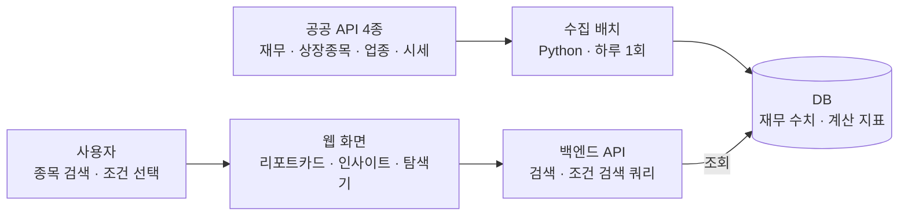

# 공공데이터 활용 계획서 — 초보 투자자를 위한 재무 인사이트 서비스

2026-10-16 · Yuchan Song

## 개요

**서비스명(가칭): 재무 레이더** — 종목 이름만 입력하면 그 회사의 재무 체력과 최근 3년의 변화를 신호등과 한 줄 인사이트로 보여주고, 원하는 재무 조건으로 종목을 걸러볼 수 있는 초보 개인투자자용 웹 서비스입니다.

| 항목 | 내용 |
| --- | --- |
| 핵심 사용자 | 주식을 막 시작한 대학생·사회초년생 개인투자자 |
| 핵심 데이터 | [금융위원회_기업 재무정보](https://www.data.go.kr/data/15043459/openapi.do) (Open API, REST, JSON/XML, 무료) |
| 보조 데이터 | [금융위원회_KRX상장종목정보](https://www.data.go.kr/data/15094775/openapi.do) (종목명 ↔ 법인등록번호 연결), [금융위원회_기업기본정보](https://www.data.go.kr/data/15043184/openapi.do) (업종), 금융위원회_주식시세정보 (시가총액, 선택) |
| 형태 | 반응형 웹 (모바일 우선) |
| 한 줄 가치 | "남들이 좋다던 종목"을 사기 전에, 그 회사의 실적과 빚이 어떻게 변해왔는지 3분 안에 확인 |
| 원칙 | 매수·매도를 추천하지 않고, 판단에 필요한 재무 사실과 그 변화만 정리해 보여준다 |

## 1. 문제의식

### 해결하고 싶은 문제

초보 개인투자자는 유튜브·커뮤니티·지인 추천으로 종목을 고르고, 그 회사가 실제로 돈을 벌고 있는지·빚이 늘고 있는지는 확인하지 않은 채 투자한다.

### 불편한 점 / 개선이 필요한 이유

- **재무 정보가 어렵다:** 전자공시(DART) 보고서는 길고, 증권 앱의 재무 탭은 숫자 표만 보여줄 뿐 "그래서 좋아진 건지 나빠진 건지"는 알려주지 않는다.
- **변화를 보기 힘들다:** 투자 판단에는 한 해의 숫자보다 3년간의 흐름(매출은 느는데 이익률은 떨어진다 등)이 중요하지만, 직접 연도별 숫자를 모아 계산해야 한다.
- **조건으로 찾기 어렵다:** "3년 연속 흑자이면서 빚이 적은 회사" 같은 조건 검색은 증권사 HTS 조건검색이나 유료 도구에 있어 초보자가 쓰기 어렵다.
- **결과가 크다:** 재무를 보지 않고 테마·소문만 따라간 투자는 실적 악화나 상장폐지 위험을 모른 채 손실로 이어질 수 있다. 개인투자자가 늘어날수록 기본 정보 격차를 줄일 필요가 커진다.

### 구체적 사례

> ⚠️ 아래는 예시입니다. 본인의 실제 경험으로 바꿔 써 주세요.

2026년 봄, 학과 단톡방에서 "곧 오를 테마주"라는 말을 듣고 용돈 50만 원으로 B사 주식을 샀다. 몇 달 뒤 주가가 40% 넘게 빠져서야 재무제표를 찾아봤고, B사가 3년 연속 영업적자에 부채비율이 300%를 넘는 회사라는 걸 알았다. 매수 전에 5분만 확인했어도 피할 수 있었지만, 당시에는 어디서 무엇을 봐야 하는지 몰랐다.

## 2. 문제 해결 방법

### 해결 아이디어

공공 API로 상장사의 최근 3개년 재무 수치를 모아 세 가지 방식으로 보여준다.

1. **재무 리포트카드:** 종목을 검색하면 안정성·수익성·성장성 신호등과 3년 추이 그래프를 보여준다.
2. **변화 인사이트:** "매출은 3년째 늘었지만 영업이익률은 12% → 4%로 줄었다"처럼 의미 있는 변화를 자동으로 찾아 한 줄 문장으로 알려준다.
3. **재무 조건 탐색기(스크리너):** "3년 연속 흑자 + 부채비율 100% 이하" 같은 조건을 클릭으로 조합해 해당 종목 목록을 보고, 같은 업종 회사와 나란히 비교한다.

### 활용 공공데이터

| 데이터 | 주요 항목 | 서비스에서 쓰는 곳 |
| --- | --- | --- |
| [금융위원회_기업 재무정보](https://www.data.go.kr/data/15043459/openapi.do) (핵심) — 요약재무제표·재무상태표·손익계산서 3개 오퍼레이션, `crno`(법인등록번호) + `bizYear`(사업연도)로 조회 | 매출액, 영업이익, 당기순이익, 자산·부채·자본총계, 자본금 | 신호등, 3년 추이, 인사이트, 스크리너 조건 |
| [금융위원회_KRX상장종목정보](https://www.data.go.kr/data/15094775/openapi.do) | 종목명, 단축코드, 시장구분, 법인등록번호 | 종목명 검색 → 법인등록번호 연결, 분석 대상 종목 목록 구성 |
| [금융위원회_기업기본정보](https://www.data.go.kr/data/15043184/openapi.do) | 업종, 설립일 | 같은 업종끼리 비교 |
| 금융위원회_주식시세정보 (선택) | 종가, 시가총액 | PER(시가총액 ÷ 순이익), PBR(시가총액 ÷ 자본총계) 계산 |

재무정보 API는 종목명으로 검색할 수 없으므로, KRX상장종목정보의 법인등록번호를 다리로 써서 두 데이터를 연결하는 것이 핵심 설계다.

### 재무 지표 → 신호등 변환 규칙 (초안)

| 영역 | 지표 (계산식) | 초록 | 노랑 | 빨강 |
| --- | --- | --- | --- | --- |
| 안정성 | 부채비율 = 부채총계 ÷ 자본총계 | 100% 이하 | 100~200% | 200% 초과 또는 자본잠식 |
| 수익성 | 영업이익률 = 영업이익 ÷ 매출액 | 5% 이상 | 0~5% | 영업적자 (2년 연속이면 강조) |
| 성장성 | 매출 증가율 = (당해 − 전년) ÷ 전년 | 5% 이상 | −5~5% | −5% 미만 |
| 가격 수준 (선택) | PER·PBR의 업종 중앙값 대비 위치 | 색 대신 "업종 대비 낮음 / 비슷 / 높음"으로만 표시 | | |

가격 수준은 높다고 나쁘거나 낮다고 좋은 것이 아니므로 신호등 색을 쓰지 않는다.

기준값은 일반적으로 쓰이는 경험칙을 출발점으로 삼고, 업종마다 적정 수준이 다르므로 구현 단계에서 업종별 보정 여부를 검토한다. 화면에는 "투자 권유가 아닌 참고 정보이며, 투자 판단의 책임은 본인에게 있다"라는 안내를 항상 표시한다.

### 기존 서비스 조사

| 서비스 | 다루는 방식 | 한계 |
| --- | --- | --- |
| 금융감독원 전자공시(DART) | 사업·감사보고서 원문 공개 | 원문이 길고 전문용어 위주, 해석과 계산은 사용자 몫 |
| 증권사 앱(MTS) 재무 탭 | 연도·분기별 재무 숫자 표 | 숫자 나열 위주, 변화의 의미는 설명하지 않음 |
| 증권사 HTS 조건검색 | 재무·시세 조건으로 종목 검색 | 메뉴와 용어가 어려워 초보자 진입 장벽이 높음 |
| 유료 투자정보·퀀트 도구 | 상세 지표, 백테스트, 스크리닝 | 유료, 중·상급 투자자 대상 |
| 종목 커뮤니티·유튜브 | 의견·전망 공유 | 근거가 불분명하고 과장·소문이 섞임 |

> 📝 제출 전에 각 서비스 화면을 직접 캡처해 근거로 첨부하면 설득력이 높아집니다.

### 차별점

1. **숫자가 아니라 변화를 말해준다:** 3년 흐름에서 눈여겨볼 변화를 규칙으로 찾아 문장으로 보여준다.
2. **초보자 눈높이의 스크리너:** 조건을 용어 대신 "빚이 적은", "꾸준히 이익을 내는" 같은 말로 고르고, 각 조건의 계산식을 함께 보여줘 배우면서 쓴다.
3. **업종 안에서 비교:** 은행과 IT 회사를 같은 잣대로 보지 않도록 같은 업종 회사와 나란히 비교한다.
4. **무료·공식 데이터:** 금융위원회 공공데이터만 사용해 출처가 분명하고 누구나 무료로 쓸 수 있다.
5. **추천하지 않는다:** "사라/팔라"는 말 대신 사실만 보여줘, 판단은 사용자가 하도록 돕는다.

### 적용 기술과 근거

- **웹 (React/Next.js):** 커뮤니티 글을 보다가 바로 검색하는 상황이라 설치 없는 모바일 웹이 적합하다.
- **데이터 수집 배치 (Python):** 스크리너는 많은 종목을 한꺼번에 비교해야 하므로, 실시간 호출 대신 시가총액 상위 약 200개 종목 × 3개년을 미리 수집해 DB에 저장한다. 약 600회 호출로 하루 1회 실행이 가능하다 (개발계정 호출 한도 확인 필요).
- **DB (SQLite 또는 PostgreSQL):** 종목·연도별 재무 수치와 계산된 지표를 저장해 조건 검색을 SQL로 처리한다.
- **데이터 분석 (규칙 기반):** 신호등·인사이트를 정해진 규칙으로 계산해 결과를 설명할 수 있고 검증이 쉽다.
- **AI (선택):** LLM으로 리포트카드를 2~3문장으로 요약한다. 수치는 규칙 계산 결과만 넘겨 사실 오류를 막고, 추천 표현은 금지 문구로 걸러낸다.

## 3. 구현 계획 및 필요 역량

### 구현 범위 (MVP)

혼자 6주 안에 만들 수 있도록, 분석 대상을 시가총액 상위 약 200개 상장사로 한정하고 리포트카드·인사이트·스크리너 3개 화면에 집중한다.

| 우선순위 | 기능 | 설명 | 사용 데이터 |
| --- | --- | --- | --- |
| 필수 | 종목 검색 | 종목명·종목코드 입력 → 법인등록번호 연결 | KRX상장종목정보 |
| 필수 | 재무 리포트카드 | 안정성·수익성·성장성 신호등 + 지표 수치 + 3년 추이 그래프 | 기업 재무정보 |
| 필수 | 변화 인사이트 | 3년 흐름에서 규칙에 걸리는 변화를 1~3줄 문장으로 표시 | 기업 재무정보 |
| 필수 | 재무 조건 탐색기 | 조건 3~5개(흑자 연속, 부채비율, 매출 증가율 등) 조합 → 종목 목록 | 수집 DB |
| 선택 | 업종 비교 | 같은 업종 종목과 지표를 한 표로 비교 | 기업기본정보 |
| 선택 | 가격 수준 | PER·PBR과 업종 중앙값 대비 위치 | 주식시세정보 |
| 확장 | AI 요약·관심종목 알림 | 리포트 2~3문장 요약, 새 사업연도 재무 반영 시 변화 알림 | LLM API |

### 필요 기술 스택 / 장비 / 데이터

| 영역 | 내용 |
| --- | --- |
| 기획 | 사용자 시나리오 2개(매수 전 확인, 조건으로 찾기), 인사이트 규칙표, 고지 문구 |
| 프론트엔드 | React(Next.js), Tailwind CSS, 차트 라이브러리(Recharts 또는 Chart.js) |
| 백엔드 | Next.js API Route 또는 FastAPI — 검색·조회 API, 조건 검색 쿼리 |
| 데이터 | Python(requests, pandas) 수집 배치, SQLite 또는 PostgreSQL(Supabase 무료 플랜) |
| 디자인 | Figma 와이어프레임 3장, 신호등은 색맹 사용자를 위해 아이콘·문구를 함께 표시 |
| 하드웨어 | 불필요 (개인 노트북, 무료 배포: Vercel 등) |
| 데이터 신청 | 공공데이터포털 회원가입 후 4개 API 활용신청 → 개발계정 인증키 발급 (자동승인) |

### 서비스 데이터 흐름

수집 배치가 공공 API에서 받은 재무 수치와 계산된 지표를 DB에 쌓아 두고, 웹은 DB만 조회해 빠르게 응답하며 호출 한도도 아낀다.

### 개발 일정 (6주)

1. **1주차:** API 4종 활용신청, Postman으로 응답 확인, 종목명 → 법인등록번호 → 재무정보 연결을 표본 10개사로 검증
2. **2주차:** 수집 배치 작성, 200개 종목 × 3개년 DB 적재, 지표 계산 로직
3. **3주차:** 검색·리포트카드 화면, 신호등과 3년 추이 그래프
4. **4주차:** 인사이트 규칙 구현, 조건 탐색기(스크리너) 화면
5. **5주차:** 주식 경험 1년 미만 친구·동기 5~10명 사용성 테스트, 설문, 수정
6. **6주차:** 배포, 발표 자료와 시연 영상 준비

## 4. 기대 효과

### 누구에게 어떤 가치를 주는지

| 대상 | 가치 |
| --- | --- |
| 초보 개인투자자 | 매수 전 3분 안에 회사의 재무 체력과 변화를 확인해, 소문만 믿는 투자를 줄이고 스스로 판단하는 습관을 만든다 |
| 학교 | 경제·경영 수업이나 투자 동아리에서 실제 기업 데이터로 재무제표 읽는 법을 익히는 금융교육 도구로 쓸 수 있다 |
| 사회 | 개인투자자의 정보 격차를 줄이고 근거 없는 테마 투자를 완화하며, 금융 공공데이터의 실생활 활용 사례를 만든다 |

### 성과 확인 방법

| 지표 | 측정 방법 | 목표 |
| --- | --- | --- |
| 재무 확인 소요 시간 | 같은 종목의 3년 재무 변화를 DART·증권 앱으로 확인할 때와 재무 레이더로 확인할 때 시간 비교 (5~10명) | 평균 70% 이상 단축 |
| 재무 이해도 | "이 회사의 이익은 늘었나, 줄었나?" 등 퀴즈 5문항 정답률 비교 | 정답률 30%p 이상 향상 |
| 데이터 정확도 | 표본 20개 종목의 지표를 DART 원문과 직접 대조 | 일치율 95% 이상 |
| 행동 변화 의향 | 사용 후 "매수 전에 재무를 확인하겠다" 응답 비율 (사용 전과 비교) | 사용 전 대비 2배 이상 |
| 사용자 만족도 | 5점 척도 설문 (이해도·유용성·재사용 의향) | 평균 4.0점 이상 |

> 📝 목표치는 5주차 사용성 테스트 결과로 실제 값을 채워 넣으면 됩니다.

## 작성자 메모 (제출 전 정리)

- [ ] 1장 "구체적 사례"를 본인의 실제 경험으로 교체
- [x] 공공데이터포털에서 API 활용신청 후, 표본 종목으로 실제 응답을 받아 항목명·연도 범위 확인 — 기업 재무정보·KRX상장종목정보·기업기본정보 3개 완료 (2026-11-04~09, 결과는 `개발기능.md`). 주식시세정보는 신청·연결 확인 완료(2026-11-12).
- [ ] 주식시세정보 API의 정확한 데이터 번호와 시가총액 항목 확인 — 시가총액 항목은 `mrktTotAmt`로 확인 (2026-11-12). 데이터 번호는 미확인
- [ ] 개발계정 일일 호출 한도 확인 → 수집 배치 주기에 반영 (KRX상장종목정보 10,000건 확인. 재무는 DART로 바뀌어 DART 일일 한도 확인 필요, 2026-11-12)

- 분석 대상을 시가총액 상위 약 200개에서 검색 대상 전체(약 2,570개)로 넓힘 (2026-11-12, 이유는 `개발기능.md` 결정 기록)
- 재무 리포트카드의 표현 방식을 신호등 대신 눈금 위 위치 + 3년 방향 화살표로 바꿈 (2026-11-12, 이유는 `개발기능.md` 결정 기록)
- "AI 요약"은 하지 않고, 스크리너에서 문장으로 조건을 찾는 챗봇(F-10)으로 바꿈 (2026-11-12, 이유는 `개발기능.md` 결정 기록)
- **핵심 재무 데이터 출처를 금융위원회 기업 재무정보에서 금융감독원 DART OpenAPI(단일회사 주요계정)로 바꿈.** 업종·결산월도 기업기본정보 대신 DART 기업개황을 씀. 종목 목록(KRX상장종목정보)과 주가(주식시세정보)는 그대로 공공데이터포털을 씀 (2026-11-12, 이유는 `개발기능.md` 결정 기록). 화면 출처 표시에 DART 추가 예정

> 이 계획서는 2026-10-16 제출 기준이다. 이후 확인·결정된 내용(금융업 데이터 없음, 스팩·코넥스 제외 등)은 [개발기능.md](./개발기능.md)가 최신이다.
- [ ] 기존 서비스 화면 캡처를 근거 자료로 첨부

**예상 리스크와 대응**

| 리스크 | 대응 |
| --- | --- |
| 투자 추천이나 투자자문으로 오해받을 수 있음 | "사라/팔라"·목표가 표현을 쓰지 않고, 모든 화면에 정보 제공 목적과 투자 책임 고지 표시 |
| 재무 데이터는 연 단위라 최신 상황과 시차가 있음 | 화면에 "기준 사업연도"를 항상 표시, 주가는 영업일 다음 날 갱신된다는 점도 안내 |
| 금융업(은행·증권·보험)은 부채비율 기준이 맞지 않음 | 금융업은 신호등 대신 별도 안내, 이후 업종별 기준으로 확장. **(2026-11-09 확인) 기업 재무정보 API가 금융업 데이터를 아예 제공하지 않으므로, "금융회사는 제공되지 않음" 안내로 처리** |
| 외국회사 상장종목은 국내 법인등록번호가 없음 | 분석 대상에서 제외하고 "지원하지 않는 종목"으로 안내 |
| 공공데이터포털 장애 시 서비스 중단 | 수집 DB에 마지막 데이터를 보관해 조회는 계속 가능하게 함 |

## 출처

- [공공데이터포털 — 금융위원회_기업 재무정보](https://www.data.go.kr/en/data/15043459/openapi.do)
- [공공데이터포털 — 금융위원회_KRX상장종목정보](https://www.data.go.kr/data/15094775/openapi.do)
- [공공데이터포털 — 금융위원회_기업기본정보](https://www.data.go.kr/data/15043184/openapi.do)
